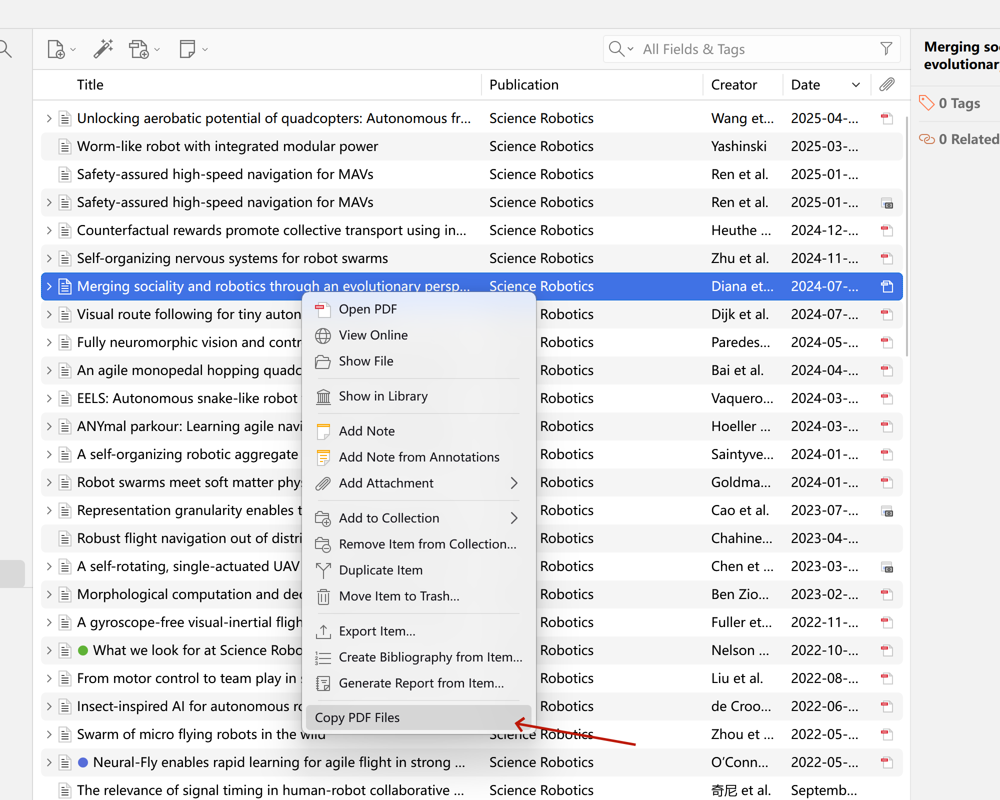

# Zotero Copy PDF

Copy local PDF attachments from Zotero to the Windows clipboard, then paste them into any folder.

## Installation

1. Download **zotero-copy-pdf.zip**.
2. Open **Tools → Plugins** in Zotero.
3. Drag the ZIP file into the Plugins window and confirm installation.
4. Restart Zotero.

## Usage

Select items or PDF attachments → right-click → **Copy PDF Files** → press **Ctrl+V** in the destination folder.

## Requirements

- Windows with Windows PowerShell.
- A Zotero version supporting the MenuManager API.
- PDF attachments downloaded locally.